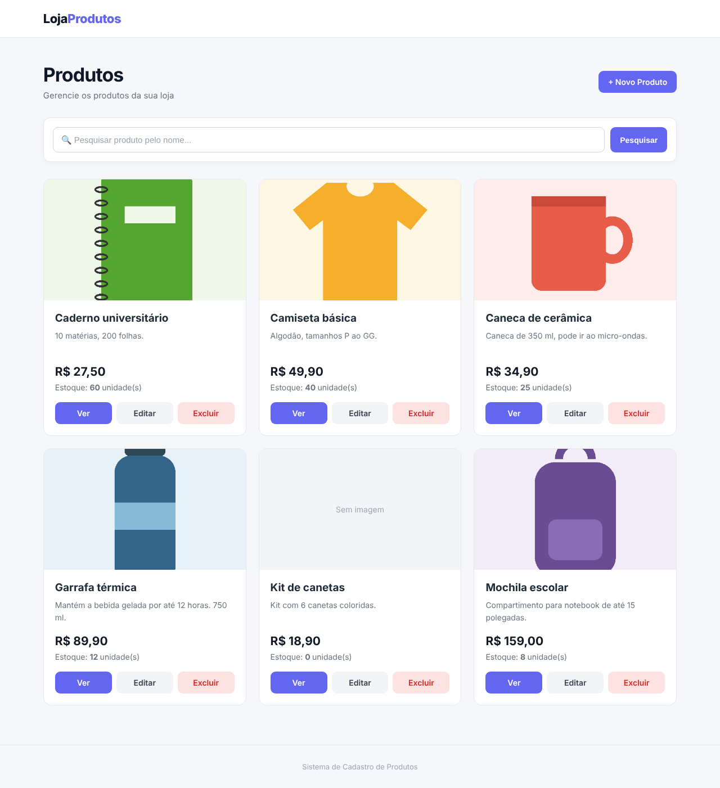
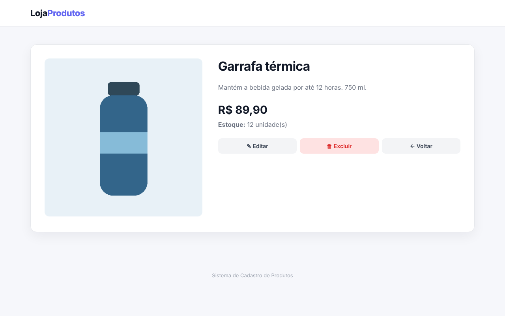
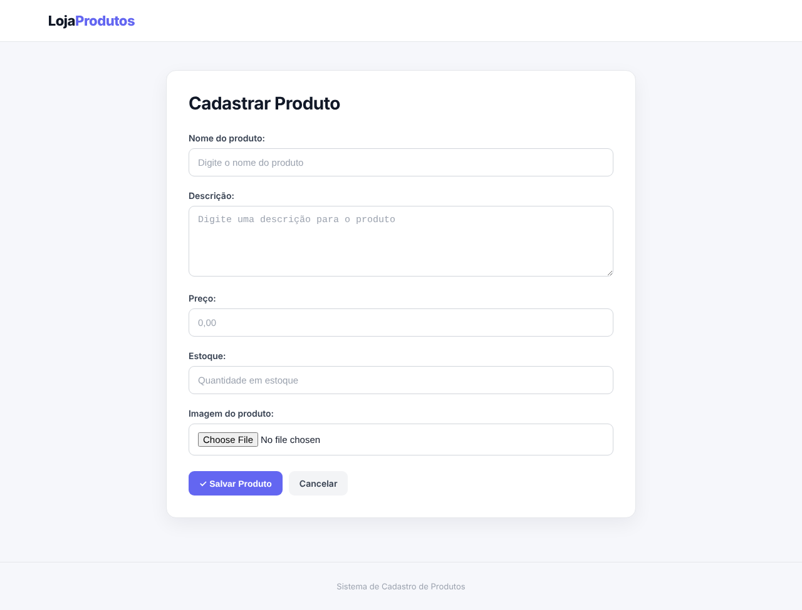
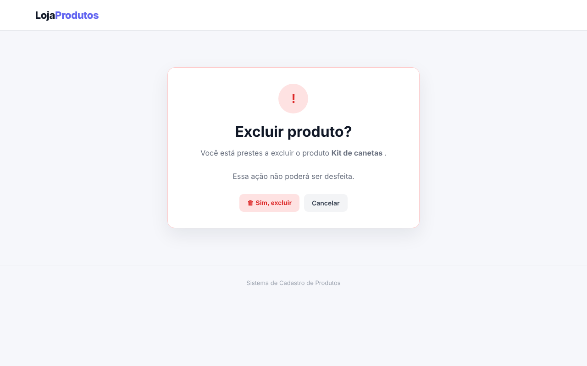

# Cadastro de Produtos com Django

Sistema web em **Python** e **Django** para cadastrar, listar, editar e excluir produtos de uma loja (CRUD completo), com upload de imagem, busca por nome e página de confirmação antes de excluir.

> **English:** Django web app for managing a store's products (full CRUD) with image upload, name search and a delete confirmation page. Built with Python, Django, SQLite and Pillow, with automated tests for every operation.



*Tela inicial com produtos de demonstração. As imagens foram geradas só para esta captura.*

## Funcionalidades

- **Listagem** de todos os produtos em cartões, em ordem alfabética, com imagem, preço e estoque.
- **Busca por nome**, que ignora maiúsculas e minúsculas.
- **Página de detalhes** de cada produto.
- **Cadastro e edição** com o mesmo formulário (`ModelForm`), validação dos campos e upload de imagem.
- **Exclusão com confirmação**: o produto só é apagado depois que o usuário confirma.
- **Mensagens de retorno** ("Produto cadastrado com sucesso", por exemplo) depois de cada ação.
- **Painel administrativo** do Django com o modelo registrado.

## Telas

| Detalhes | Cadastro | Confirmação de exclusão |
|---|---|---|
|  |  |  |

## Modelo

| Campo | Tipo | Observação |
|---|---|---|
| `nome` | `CharField(200)` | Obrigatório |
| `descricao` | `TextField` | Opcional |
| `preco` | `DecimalField(10, 2)` | Obrigatório |
| `estoque` | `IntegerField` | Obrigatório |
| `imagem` | `ImageField` | Opcional, salva em `media/produtos/` |

## Rotas

| URL | View | Ação |
|---|---|---|
| `/` | `lista_produtos` | Lista e busca (`?busca=`) |
| `/produto/<id>/` | `detalhe_produto` | Detalhes |
| `/cadastrar/` | `cadastrar_produto` | Novo produto |
| `/editar/<id>/` | `editar_produto` | Edição |
| `/excluir/<id>/` | `excluir_produto` | Confirmação (GET) e exclusão (POST) |
| `/admin/` | Admin do Django | Painel administrativo |

## Como rodar

Requer Python 3.12 ou mais recente.

```bash
python -m venv venv
source venv/bin/activate        # no Windows: venv\Scripts\activate
pip install -r requirements.txt
python manage.py migrate
python manage.py createsuperuser   # opcional, para usar o /admin/
python manage.py runserver
```

Depois é só abrir http://127.0.0.1:8000/.

A `SECRET_KEY` e o modo de depuração podem ser definidos pelas variáveis de ambiente `DJANGO_SECRET_KEY` e `DJANGO_DEBUG`. Sem elas, o projeto usa uma chave de desenvolvimento e roda com `DEBUG` ligado, o que serve só para uso local.

## Testes

```bash
python manage.py test
```

São 7 testes cobrindo listagem, busca, cadastro com imagem, validação de campos obrigatórios e do estoque, edição e a exclusão em duas etapas.

## Estrutura

```
cadastro-produtos-django/
├── config/            # configurações e URLs do projeto
├── produtos/          # app com modelo, formulário, views, templates, CSS e testes
├── docs/              # capturas de tela
├── manage.py
└── requirements.txt
```

## O que eu faria diferente hoje

- **Estoque negativo.** `IntegerField` aceita valores como -5. Eu usaria `PositiveIntegerField`, e para o preço um `MinValueValidator`.
- **Arquivos de imagem órfãos.** Ao trocar a imagem ou excluir um produto, o arquivo antigo continua na pasta `media/`. Eu apagaria o arquivo junto com o registro.
- **Paginação.** Com muitos produtos, a lista ficaria longa. O `Paginator` do Django resolveria isso.
- **Views baseadas em classe.** As `ListView`, `CreateView`, `UpdateView` e `DeleteView` do Django fariam o mesmo CRUD com menos código.
- **Login.** Hoje qualquer pessoa com acesso ao site pode cadastrar e excluir. Eu exigiria login nas telas de alteração.

---

Desenvolvido por **Isadora Fernanda Zappe Schmidt** · [LinkedIn](https://www.linkedin.com/in/isadora-fernanda)
